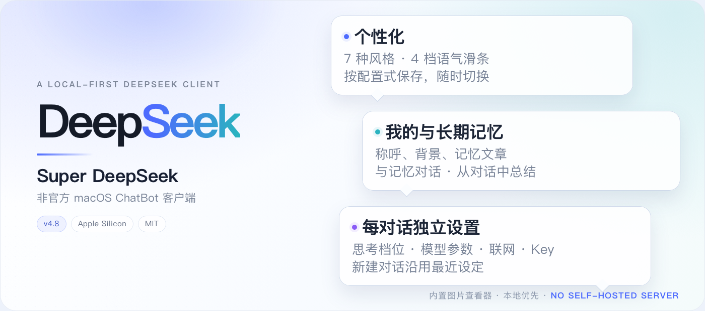
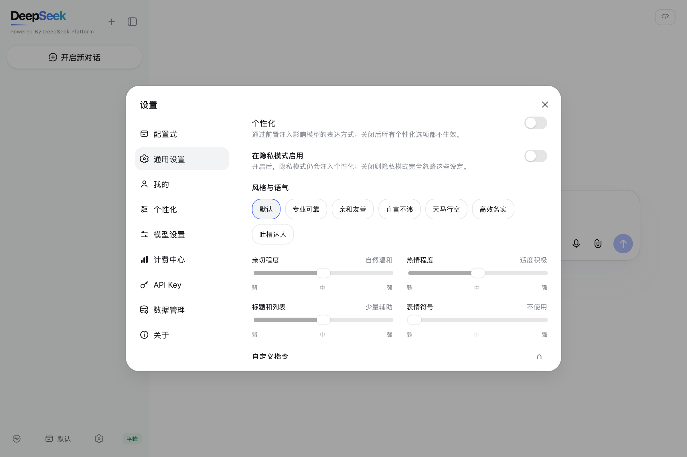
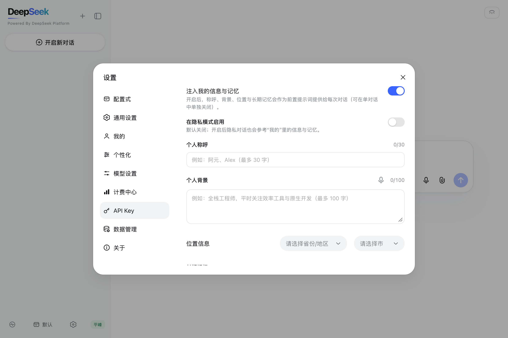
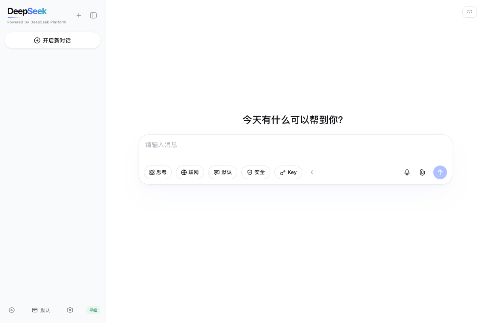
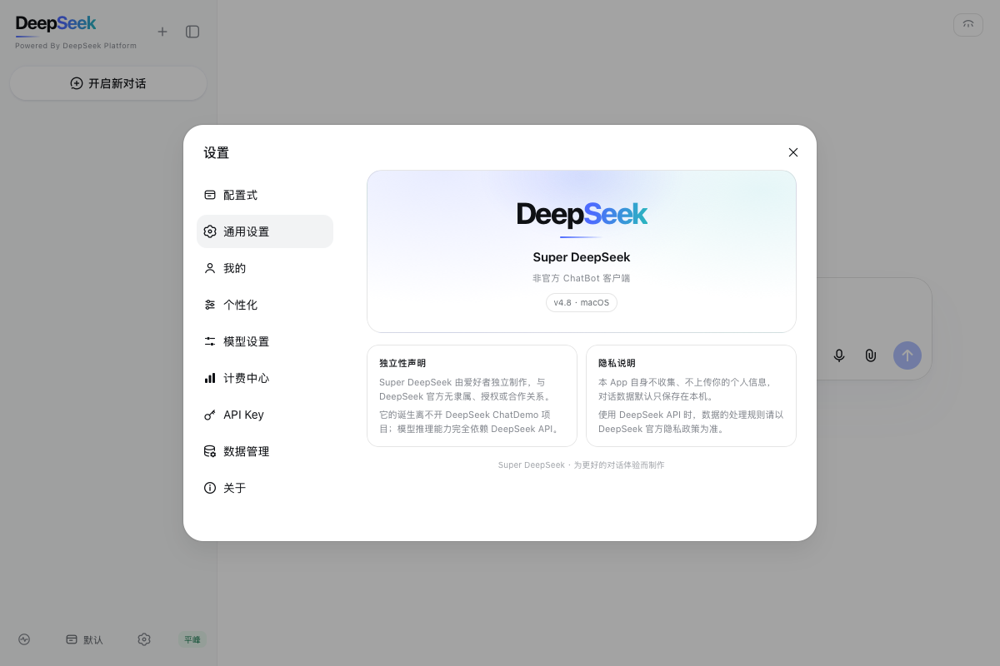

# Super DeepSeek

**非官方出品 · Unofficial Project**

> 一个面向 macOS 的非官方 DeepSeek ChatBot 客户端：本地优先，专注个性化表达、模型参数设定、长期记忆与每对话独立设置。

[](LICENSE)


<p align="center">
  
</p>

> **非官方出品：** Super DeepSeek 由爱好者独立制作，不是 DeepSeek 官方产品，与 DeepSeek 官方不存在隶属、授权或合作关系。
> 项目受到 DeepSeek ChatDemo 的启发并基于其前端继续开发；模型推理能力完全依赖 DeepSeek API。
> 本 App 自身不收集、不上传你的个人信息；使用 API 时的数据处理规则以 DeepSeek 官方政策为准。

<p align="center">
  <a href="https://eyuihiu.github.io/Super-DeepSeek/"><b>▶ 在线体验 Web 预览版</b></a><br>
  <sub>需自备 API Key；Web 版不包含原生菜单与保存面板，完整功能请下载 macOS App。</sub>
</p>

## 目录

- [给普通用户](#给普通用户)
- [个性化](#个性化)
- [我的与长期记忆](#我的与长期记忆)
- [更多功能](#更多功能)
- [数据、隐私与导出](#数据隐私与导出)
- [常见问题](#常见问题)
- [给专业用户](#给专业用户)
- [开源前必须注意的风险](#开源前必须注意的风险)
- [许可证](#许可证)

---

# 给普通用户

## 这是什么

Super DeepSeek 是一个把 DeepSeek API 包装成原生 macOS 应用的客户端：

- 有自己的窗口、菜单、快捷键和保存面板，不像网页一样依赖浏览器标签；
- 对话、附件、设置都保存在本机；
- 需要你自己的 DeepSeek API Key，API 调用产生的费用由你的账号承担；
- 不是 DeepSeek 官方客户端，也不代表官方立场。

## 五分钟开始

1. 从 [Releases](https://github.com/EyuiHiu/Super-DeepSeek/releases) 下载最新的 `.dmg`；
2. 打开 DMG，把 **Super DeepSeek.app** 拖进「应用程序」；
3. 第一次打开时，在 App 上右键 → **打开**（应用未公证，系统提示属于正常现象）；
4. 打开「设置 → API Key」，填入你的 DeepSeek API Key；
5. 回到首页开始对话。

> 不要把 API Key 发给别人，也不要提交到 GitHub、截图或 issue 里。Key 只保存在你本机的应用存储中。

## 个性化

<p align="center">
  
</p>

打开「设置 → 个性化」：

- **总开关**：关闭后所有个性化选项都不生效；
- **在隐私模式启用**：默认关闭；关闭时隐私模式完全忽略个性化；
- **7 种风格**：默认、专业可靠、亲和友善、直言不讳、天马行空、高效务实、吐槽达人；
- **四档滑条**：亲切程度、热情程度、标题和列表、表情符号；
- **自定义指令**：用自然语言补充你希望模型保持的表达方式。

个性化内容会作为前置指令追加在**系统提示词之后**；系统提示词优先于个性化。配置式会保存个性化设置；每个对话可以单独关闭「个性化」。

## 我的与长期记忆

<p align="center">
  
</p>

「设置 → 我的」用于告诉模型「你是谁」，包括：

- 个人称呼（最多 30 字）；
- 个人背景（最多 100 字）；
- 位置：省市/地区；
- **长期记忆**：一篇只读的、文章式的个人档案，而不是碎句列表。

### 记忆是怎么工作的

- 记忆保存在全局「我的」设置里，所有对话共用同一篇记忆；
- 开启「注入我的信息与记忆」后，称呼、背景、位置和记忆会作为独立段落追加到 system prompt；
- 每个对话还有「个人信息（我的）」开关；只有总开关和对话开关都开启时才会注入；
- 隐私模式默认不注入；可以在「我的」里单独开启「在隐私模式启用」；
- 旧对话也可以使用记忆：继续发消息、重新生成或续写时，会使用当前记忆；已经生成的历史回答不会被追溯改写。

### 三种整理记忆的方式

1. **只读文章式记忆**：在「我的」里滚动阅读；记忆被要求以第三人称连贯段落保存；
2. **与记忆对话**：进入二级对话界面，用自然语言补充/修正个人信息；模型会实时给出新记忆草稿，确认后才覆盖；
3. **对话菜单 → 记忆总结**：从某个对话的完整上下文提炼值得长期保留的信息；不会向原会话写入任何消息；展示要点和新旧对比，确认后保存。

记忆最多 4000 字符，只保存在本机；不会自动上传到除 DeepSeek API 之外的地方。

## 更多功能

### 对话与分支

- 多会话列表，自动标题、重命名、置顶、删除；
- 编辑已发送的问题、重新生成回答；
- 同一问题可以保留多个回答分支，随时切换；
- 停用/继续生成，适合长回答；
- 上下文压缩：把较早的轮次压成摘要继续对话，原始消息仍然保留在本地。

### 思考与搜索

- 思考档位：关闭 / 低 / 高 / 最高；
- 联网搜索、链接阅读与来源引用；
- 支持工具调用结果和图片搜索卡片；
- 输入框快捷区可以一键切换，也可以在每个对话的设置里单独管理。

### 附件、语音与图片

- 拖拽、粘贴或选择文件上传；
- 图片附件有缩略图；
- **内置图片查看器**：点击图片即可查看原图，支持滚轮缩放、拖拽平移、双击切换、保存；
- 语音输入调用 DeepSeek ASR；回答可以朗读；
- 移动端录音时显示实时频谱。

### Markdown 与阅读体验

- GFM Markdown、代码高亮、KaTeX 公式；
- Mermaid 图表；
- 长回答流式渲染，并针对 Markdown 做了节流；
- 浅色/深色主题、中英文界面、移动端布局。

### 配置式与「每对话设置」

- **配置式**相当于一套完整设置空间：主题、语言、音色、位置、模型、Key、个性化、我的信息等；
- 每个对话独立保存思考档位、联网、系统提示词、安全审核、API Key 和个性化/个人信息开关；
- 新建对话沿用最近一个对话的设定；App 启动时也使用最近对话的设定；
- 旧对话不会因为切换全局设置而被悄悄改掉。

### 计费、状态与隐私

- 多家 API Key 管理，按 Key 隔离计费；
- 计费中心展示每日 Token、缓存命中、输出、峰谷价格与估算费用；
- 侧栏显示 DeepSeek 服务可用性状态；
- 隐私模式：不落库、不计费、默认关闭联网与安全审核，退出后恢复；
- 「清除所有数据」可以彻底删除本机会话、附件、Key、配置式、缓存和偏好，完成后提示退出。

### 数据导入导出

- 设置向导：按活跃时间/创建时间/轮数分组、搜索、多选；
- 单会话导出 ZIP；
- 归档可选密码保护（PBKDF2 + AES-GCM）；
- 导入时自动识别加密归档，并展示新增/冲突；
- 支持从官方 DeepSeek 导出的历史归档导入。

> 导出仅包含会话与本地可用的图片原件，不包含 API Key、设置或非图片附件原件。

## 界面预览

### 首页

<p align="center">
  
</p>

### 关于

<p align="center">
  
</p>

# 数据、隐私与导出

## 本地存储

- API Key、设置、配置式：浏览器 `localStorage`；
- 会话、消息、附件原件：IndexedDB；
- macOS 原生版存储目录：`~/Library/WebKit/local.deepseek.chat`；
- 与 Safari/Chrome 隔离；移动 App 到其他目录不会改变数据归属。

## 什么会发给 API

发送消息、上传附件、语音输入/朗读、联网搜索时，相关内容会发送给 DeepSeek API。这是模型工作的必要条件，不代表 App 自己收集数据。

## 清除所有数据

设置 → 数据管理 → 清除所有数据：

- 会删除本机会话、附件、Key、配置式、计费记录、缓存与偏好；
- 先倒计时确认，完成后弹出原生提示并退出 App；
- 重新打开是全新状态，需要重新填写 API Key；
- 不会删除你手动导出到 Finder 的 ZIP 或备份。

## 导入限制

- 官方归档通常只带图片原件；**非图片附件（PDF、Office 等）可能只有文件名和元数据，没有实际内容**；
- 导入的历史消息通常没有 Token 用量，因此旧对话的计费统计会从 0 开始；
- 每对话设置、个性化、Key 等属于本机设置，不会随官方归档导入；
- 导入前建议先备份当前数据。

# 常见问题

### 第一次打开提示「无法验证开发者」

不是病毒，是未做 Apple 公证。右键 App → 打开，或到「系统设置 → 隐私与安全性」允许。

### 为什么需要 API Key

App 本身不提供模型服务；推理完全依赖 DeepSeek API，费用由你的 API 账号承担。

### 图片为什么不能像浏览器一样打开

旧版本会把 `blob:` 地址交给系统默认应用，macOS 找不到对应程序。现在版本使用内置图片查看器；如果仍出现系统弹窗，请确认使用的是最新版。

### 支持 Windows / Intel Mac 吗

当前原生包为 Apple Silicon macOS 12+；其他平台需要自行构建或适配。

### 数据能同步到云端吗

不会自动云同步；请使用导出 ZIP 自行备份。

---

# 给专业用户

## 架构

```text
┌──────────────────────────────┐
│ React + TypeScript + rspack  │  chat-demo/
│ 静态页面，无自建后端          │
└──────────────┬───────────────┘
               │ file:// 加载
┌──────────────▼───────────────┐
│ AppKit + WKWebView           │  macapp/
│ 原生窗口、菜单、权限、保存    │
└──────────────┬───────────────┘
               │ HTTPS / SSE
┌──────────────▼───────────────┐
│ DeepSeek API                 │
│ Messages / Files / ASR / TTS │
└──────────────────────────────┘
```

- 没有本地 HTTP 服务，没有监听端口；
- Web 端是唯一状态源，原生菜单通过桥接镜像状态；
- 会话与附件存 IndexedDB，原生层只负责窗口、文件、剪贴板、下载和清理。

## 仓库结构

```text
.
├── chat-demo/                 # React 前端（上游 ChatDemo 的衍生开发）
│   ├── src/app/               # 布局、主题、原生桥
│   ├── src/components/        # 聊天、设置、Markdown、图片查看器
│   ├── src/services/          # API、会话、存储、记忆、计费、语音
│   └── rspack.config.ts
├── macapp/                    # macOS 原生壳
│   ├── App.swift              # WKWebView、菜单、下载、全量抹除
│   ├── NativeMenu.swift       # 原生菜单与 Web 桥
│   ├── build.sh
│   └── make_dmg.sh
├── docs/screenshots/          # README 截图（已脱敏）
└── tools/                     # 辅助脚本
```

## 开发环境

- Node.js 22.12+
- pnpm
- macOS 12+，Xcode Command Line Tools（构建原生壳）
- Apple Silicon（当前构建目标 `arm64-apple-macos12.0`）

```sh
cd chat-demo
pnpm install
pnpm dev        # http://localhost:8090

pnpm type       # TypeScript
pnpm lint       # oxlint
pnpm format     # oxfmt
pnpm build      # dist/

cd ../macapp
./build.sh      # build/Super DeepSeek.app
./make_dmg.sh   # build/Super DeepSeek 4.8.dmg
```

## 提示词组装顺序

每次回复请求的 system 大致为：

```text
systemPrompt
  + composeMePrompt(...)          # 我的：称呼/背景/位置/记忆
  + composePersonalizationPrompt  # 个性化
```

`composeMePrompt` 只有在以下条件同时满足时返回内容：

- `me.enabled` 为真；
- 当前对话 `chatSettings.personalInfo` 未关闭；
- 隐私模式下 `me.applyInPrivacy` 为真（非隐私模式不需要）。

`latest_reminder` 是独立的提醒字段；当「我的」被禁用时，位置不会进入提醒。个性化与「我的」都是**每次请求动态拼接**，不写入消息历史，因此改设置后下一轮生效，旧回答不回溯。

## 每对话设置

`Session.chatSettings` 保存：

```ts
{
  thinking, thinkingEffort,
  search,
  systemPrompt,
  safety: { enabled, level },
  activeKeyId,
  personalization,
  personalInfo
}
```

- 导入的旧会话没有该字段时，首次打开按当前设置补快照；
- 新建对话沿用最近对话；
- 启动时读取最近一个对话的设置；
- 对话内修改只写回该对话，不污染配置式。

## 记忆与总结

- `composeMePrompt()` 把全局 `MeSettings.memory` 注入 system；
- `converseWithMemory()` 用自然语言修改记忆草稿，输出 `<memory>` 块，确认后写入 `me.memory`；
- `extractMemoryFromSession()` 从可见上下文提取记忆；如果存在 `compaction`，从压缩点后继续，不向原会话写入；
- 记忆请求本身用独立 system prompt，不计入原会话消息。

## 数据与归档

- IndexedDB `chat-demo`：`sessions`、`sessionSummaries`、`files`；
- `sessionSummaries` 保存列表元数据，打开会话时才加载消息；
- 归档使用 ZIP；可选 AES-GCM 加密，PBKDF2-SHA256 派生；
- 归档扩展字段 `compaction` 用于保留压缩状态，官方客户端会忽略；
- 导出图片原件，不导出非图片附件、Key、设置；
- 旧归档没有历史 usage，计费统计从本机新消息开始。

## 原生壳行为

- `file://` 加载 `Contents/Resources/web/index.html`；
- 单实例，避免两个窗口写同一 IndexedDB；
- 文件选择、保存、下载走系统面板；
- 图片查看器在 Web 内实现，避免 `target=_blank` 打开 `blob:null`；
- 全量抹除会清空所有 WebKit 来源、缓存、HTTPStorages、偏好，并在提示后退出；
- ad-hoc 签名，未公证；分发前需 Developer ID 签名 + notarization。

## 自检

```sh
"build/Super DeepSeek.app/Contents/MacOS/DeepSeekChat" --selftest
```

自检覆盖 WKWebView 的麦克风/文件选择 selector、原生桥 ready、菜单搜索、IndexedDB 持久化。

## 贡献

- 提交前运行 `pnpm type && pnpm lint && pnpm build`；
- 原生变更同时运行 `./macapp/build.sh`；
- 不要提交 API Key、会话导出、DMG、`node_modules`、`dist`；
- 截图必须脱敏；不要暴露真实对话、Key、文件路径和个人信息；
- 新增第三方依赖时更新 `THIRD_PARTY_NOTICES.md`。

---

# 开源前必须注意的风险

1. **仓库里可能带有私人数据**
   - 根目录的 `deepseek_merged-*.zip` 是完整的个人对话归档，**绝不能提交**；
   - `.gitignore` 已排除该文件、`*.dsarchive`、`audit-out/`、`macapp/build/`、`chat-demo/dist/` 等；
   - 如果它已经进入过 Git 历史，必须用 `git filter-repo` 清除并重新 clone；只删工作区文件不够；
   - 检查 `git log --all --stat` 和 `git rev-list --objects --all` 是否包含 ZIP/Key/日志。

2. **品牌与商标**
   - 「DeepSeek」名称、字标、图标属于 DeepSeek；MIT 许可证不授予商标权；
   - 项目名为 Super DeepSeek，必须在 README、About、发布页明确「非官方、无隶属关系」；
   - 不要使用官方 Logo 暗示官方背书；如收到品牌方要求，应准备改名或替换字标。

3. **上游许可证**
   - `chat-demo` 来自 DeepSeek ChatDemo，原 `LICENSE` 为 MIT，版权人为 DeepSeek；
   - 必须保留上游版权与 MIT 许可声明，不能把上游代码说成完全原创；
   - 本仓库推荐继续使用 MIT（见下方），不要删除 `chat-demo/LICENSE`。

4. **第三方依赖**
   - React、rspack、KaTeX、Mermaid、Prism、fflate、idb、Zustand 等有各自许可证；
   - 发布前生成完整依赖清单，保留 `THIRD_PARTY_NOTICES.md`；
   - 不要把第三方素材当作自己的原创资产。

5. **API 条款与隐私**
   - 用户需要自己的 API Key；不能把 Key 打进安装包或示例；
   - 对话、附件、语音会发送给 DeepSeek API；README 不能宣称「完全不上传任何数据」；
   - 需要遵守 DeepSeek 的服务条款、隐私政策和用量/计费规则。

6. **安全与数据丢失**
   - API Key 存在本地 localStorage，任何能读取用户目录的恶意程序都可能读取；
   - 导入/覆盖、清除所有数据都是不可逆操作，需保留确认；
   - 归档密码丢失无法恢复；
   - 不要在没有备份的情况下建议用户直接导入覆盖。

7. **分发与签名**
   - 当前 ad-hoc 签名、未公证；陌生用户第一次打开会被 Gatekeeper 拦截；
   - 开源代码不等于可直接安全分发；Release 需要说明右键打开方式，或完成签名/公证；
   - 不要把个人开发者证书、密码、Apple ID 凭据提交到仓库。

8. **数据完整性限制**
   - 官方归档通常只包含图片；非图片附件可能缺失；
   - 历史消息没有 usage，导入后的旧对话计费统计为 0；
   - 这些限制应写进 README/Release Notes，避免用户误以为「全部恢复」。

9. **截图与演示数据**
   - README 截图必须使用脱敏数据；不要出现真实姓名、对话、Key、文件路径；
   - 本仓库 `docs/screenshots/` 使用空数据生成，可替换为自己的截图，但发布前重新检查。

10. **出口/加密合规**
    - 归档使用 AES-GCM；一般开源个人项目风险很低，但如面向受监管地区分发，需自行确认当地加密出口/进口规定。

## 推荐许可证：MIT

**推荐继续使用 MIT。**

理由：

- 上游 `chat-demo` 已是 MIT，派生项目继续 MIT 最简单，许可证兼容；
- 允许商业使用、修改、再分发，社区接受度高；
- 只需保留版权与许可声明，不强制公开修改；
- 对本项目这种「客户端 + 静态前端」的工具足够。

如果更在意专利授权与商标条款，可以选 **Apache-2.0**：

- 包含明确的专利授权和商标条款；
- 但与上游 MIT 代码混合时，必须保留 MIT 声明，整体许可证表达要清楚；
- 对个人开源项目而言，MIT 更轻量。

不建议默认使用 GPL：它会要求分发衍生作品时公开源代码，可能限制你希望的传播方式。

---

# 许可证

本项目推荐并采用 **MIT License**。详见根目录 [LICENSE](LICENSE)。

- 上游 DeepSeek ChatDemo 的 MIT 版权声明保留在 [chat-demo/LICENSE](chat-demo/LICENSE)；
- 第三方依赖与素材见 [THIRD_PARTY_NOTICES.md](THIRD_PARTY_NOTICES.md)；
- 商标与官方关系声明见 [TRADEMARKS.md](TRADEMARKS.md)。

> Super DeepSeek is an unofficial project and is not affiliated with, authorized by, or endorsed by DeepSeek.
